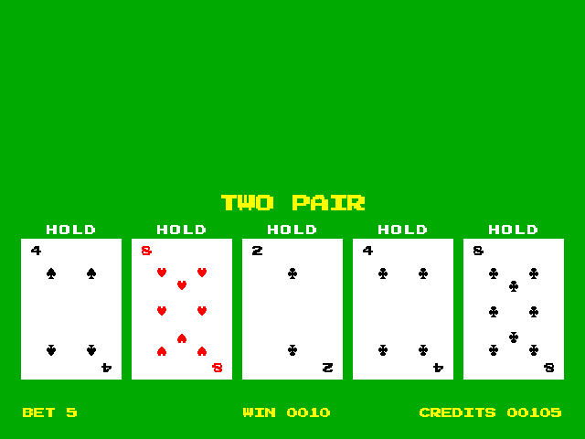

# VGA area experiment

This branch is an isolated experiment based on renderer commit `5b52905`.
The payout sheet is removed, as authorized. Card artwork, pips, rotations,
HOLD persistence, hand names, colors, footer layout, game state transitions,
credits, payouts, PRNG sequence, and button timing retain their baseline behavior.
The blank upper area is intentional; no other elements have been moved.

## Physical follow-up on the 1×1 tile

The previous [GDS run](https://github.com/h4kyu/tapeout/actions/runs/44355650876/job/134982917889)
stopped at 119.475% in global placement. I reproduced the physical flow locally
with LibreLane 3.1.0.dev6, GF180 PDK revision
`792ef67037d74c8c51811eab3ce23cf793491296`, the TT 1×1 DEF, 7-track
library, 40 ns clock, and the merged config from that run. The local tools ran
on Linux arm64. Both runs used the custom ABC recipe.

| Same display, payout sheet already removed | Previous CI | Current local RTL |
| --- | ---: | ---: |
| Movable standard cells before placement | 51,729.89 µm² | 45,506.50 µm² |
| Fixed tap and endcap area | 1,870.31 µm² | 1,870.31 µm² |
| Placer adjustment for pin density | 8,123.30 µm² | 6,821.79 µm² |
| OpenROAD global-placement utilization | 119.475% | **104.455%** |

This saves **6,223.39 µm²** of mapped cells. The placer still reports 2,231.63
µm² more effective area than available. In a separate full-display diagnostic,
suppressing virtual pin inflation got through global placement. Electrical
repair then raised actual movable area to **105.0% of the available rows**.

The production account stores four BCD digits and the units 0/5 bit. An award
or wager changes affordability and the observed binary balance immediately.
The decimal bank commits once at the same 17-clock boundary as the former
converter. This specialization is enabled for debounce periods of at least
2,048 clocks. Successive rising button pulses require a release and another
press. From an accepted draw the eight-bit maximal PRNG visits every nonzero
state within 255 clocks, so even five sequential replacement searches plus
controller transitions finish before another production press can overlap
that commit. Short-debounce and standalone callers retain the general account
and converter. The font now groups identical pixel-coordinate sets and selects
one ink bit. The chip also uses a fixed 19-bit shift recurrence for the
500,000-clock button qualification, a shared absolute grid for hand-name
addressing, and the completed category captured before its first visible state.

Validation covered 22 chip tests, 17 host tests, 7 simulation tests, seven SAT
comparisons, the existing decimal converter sweep and a new exhaustive wallet
sweep covering 13,108 reachable balances. A four-state run checked 100,000
core cycles. A separate production comparison against `9a6b7c0` checked every
VGA output bit, both clock phases, displayed digits, accepted presses and
game state across 15,001,259 clocks, including rejected just-short presses,
reset and six draws. Reproduce the last check from `test/` with
`python3 -m sim.synthesis.production_equivalence --reference 9a6b7c0`.

### Display alternatives measured outside the branch

I tested separate netlists before selecting any visual change. Removing the
hand-name band alone passed global placement in a tuned run and exhausted the
rows during clock-tree synthesis. A centered rank and suit removes the pip
matrix, mirrored corners and J/Q/K center artwork. The shortlisted alternatives
also use 128-pixel card slots, 16-pixel text cells, a compact 3×5 alphabet and
smaller clock buffers. The comparison keeps the same 1×1 DEF, 40 ns period,
production debounce and nine timing corners. The exploratory runs set slew
and capacitance repair margins to zero in the early flow; the extracted reports
still check the original design rules. Layout estimates from isolated cuts
must not be added together.

All three routed prototypes below had zero detailed-route DRC errors, zero
Magic DRC errors, and a clean LVS comparison. Results are post-route with
extracted parasitics. The compact renderers pipeline video and sync together
by two pixel clocks. The flow reports one max-fanout violation in each case.

| Centered rank over suit | Final cell utilization | Worst setup at 25 MHz | Worst hold | Max-slew violations |
| --- | ---: | ---: | ---: | ---: |
| Keep hand names, pipelined text | 92.01% | −7.133 ns | +0.170 ns | 490 |
| Keep hand names, simplified glyph logic and split decimal carry | 92.51% | −3.091 ns | +0.105 ns | 581 |
| Remove hand names, split carry and late electrical repair | **84.70%** | **0.000 ns** | **+0.126 ns** | **163** |

The third prototype passed setup and hold across all nine corners and retained
HOLD, BET, CREDITS and WIN/GAME OVER. This is sufficient for the area and
clock-period targets in that layout. Tapeout still requires closing slew and
fanout. The utilization difference includes mapping and repair differences
and cannot be attributed entirely to removing the hand name. A left-aligned
full-name variant still had 613 detailed-routing violations after 15 iterations
when the trial was stopped. All visual alternatives remain scratch prototypes.

## Original synthesis experiment

GF180 MCU 7-track 5V typical 25°C/3.3V, production 500,000-cycle debounce,
Yosys 0.33. All counted instances are real GF180 standard cells; the receipt
rejects unmapped cells and includes the latch and integrated-clock-gate area.

| Configuration | Mapped area (µm²) | Usable-core utilization |
| --- | ---: | ---: |
| Original renderer, original reported mapping | 78,965.7344 | 151.95% |
| Original renderer, experimental area recipe | 68,707.5648 | 132.21% |
| Optimized RTL, original mapping recipe | 58,502.0800 | 112.58% |
| Optimized RTL, experimental area recipe | **51,806.7200** | **99.69%** |
| Usable 1×1 core | 51,966.9700 | 100% |

The experimental result has only **160.25 µm² of headroom** and
2,506 mapped cells. This crosses the requested synthesis-area
threshold, but it is **not physical-fit or timing signoff**. Clock-tree cells,
ties, placement, routing, hold repair, and corner timing have not been closed.
The custom area mapper does not enforce a 40 ns timing target merely because
`-D 40000` is passed to ABC. The original mapping recipe still exceeds capacity;
the sub-100% result depends on both RTL changes and the experimental recipe.

Full source/library/recipe hashes and cell counts are in
[the measurement receipt](measurements/vga-area-experiment.json).

The table and receipt describe the original experiment commit, `75a8c57`.
After giving each gated card bank its own register for Verilator lint, the
same standalone area recipe maps 51,782.57 µm² (99.65%). The GDS workflow now
pins LibreLane 3.1.0.dev6 and selects the checked-in `area.abc` through
`SYNTH_ABC_STRATEGY_SCRIPT`. Check the LibreLane synthesis log for
`Using custom ABC strategy script` to verify that the hook was applied.

## Retained changes

- Remove the payout panel and its text request from the compositor. Its
  character table remains available for hand names. Uninstantiated payout
  source contributes no hardware.
- Track used cards as the union of the initial hand and current hand. This
  removes the separate ten-entry history while still rejecting discarded
  cards. The core permits one initial deal and at most one draw per round.
- Store the initial-hand snapshot in a pulse-open latch bank: its input does
  not change on the accepted start-draw edge or during that armed high phase.
  This is a specific stability guarantee, not a general latch replacement.
- Use actual GF180 integrated clock gates for five card banks, the balance,
  and three converter banks, reducing feedback muxes. There are no fabricated
  zero-area memories or ignored storage cells in the measurement.
- Recognize rank-match patterns instead of summing ten pair flags. Decode rank
  presence directly, and test the five required straight bits rather than
  thirteen bits. The standalone evaluator still validates arbitrary card codes.
  The core's evaluator uses the dealer's valid/unique-card guarantee; partial
  initial hands still expose category zero until the fifth card is present.
- Share balance addition/subtraction, retaining full 16-bit credit semantics,
  saturation at 65535, and exactly-once awards. Use the existing countdown
  debounce implementation from `748a107`, with unchanged accepted-edge timing.
- Factor font rows into shared vertical masks. The complete 64×16 row lookup
  is unchanged, including blank fallbacks. There is still one shared font.
- Share card/HOLD column geometry, use constant-division hand positioning,
  select a footer origin before subtracting, and reduce its character-cell
  decoder. Select font requests by disjoint vertical regions.
- Bound converter working precision and its BCD adjustment truth table.
  Production balances are always multiples of five: reset 100, wager 5, every
  award, and saturation 65535 preserve this invariant. The displayed units digit
  therefore stores one bit for 0/5. Generic converter mode retains all balances.
  Atomic 17-clock commits and mid-conversion update behavior are preserved.
- Initialize native reset with a real high-to-low transition at time zero.
  Gated registers cannot rely on a root-clock edge while reset is low; observed
  clock counts and replay schedules are unchanged.

The ASIC-only storage paths use `gf180mcu_fd_sc_mcu7t5v0__latq_1` and
`gf180mcu_fd_sc_mcu7t5v0__icgtp_1`. Portable simulation models match their Liberty
logic. These technology-specific paths require the GF180 library to be loaded
before synthesis hierarchy checking. Clock-gating checks, latch timing, and
post-CTS hold timing require particular attention before adopting this branch.

## Validation

- 22 chip tests, 17 host tests, and 7 Cocotb harness tests pass.
- Native and independent four-state pin captures match all five baseline
  screenshots after replacing only the permitted payout area with green.
- All 65,536 generic credit balances and 13,108 production balances convert
  correctly. The standalone HDL test also checks 17-clock commit timing and
  digit requests at every balance.
- Seven SAT checks prove card geometry, HOLD geometry, hand-message addressing, the full
  font ROM, the standalone evaluator, and footer addressing equivalent to the
  baseline, including the production evaluator under the dealer guarantee.
  Inactive addresses are masked; footer digits are constrained to
  valid BCD. Active glyph-coordinate bounds are also proved.
- A 100,000-cycle four-state comparison checks every core output at both half
  phases against the baseline, with resets, random raw controls/candidates,
  stalls, repeated cards, and the production balance invariant.

These checks establish the tested behavioral contract, not an all-state
sequential proof or transistor-level timing guarantee.

## Simulator cost

The gated-clock simulation model is more expensive to evaluate. Flattening and
link-time optimization in the native build improved a warm run from about
7.34 million to 8.84–8.94 million clocks/s: approximately **21 generated FPS**.
This does not meet the earlier 30 FPS software-viewer target; browser presentation
FPS was not measured. Hardware pixel-clock/sync timing and simulated clock
schedules are unchanged. This is an additional reason to treat the branch as a
research result rather than a drop-in replacement.

## Reproduce

From `test/` with Icarus, Verilator, and Yosys installed:

```sh
make test-sim
make COCOTB_PLUSARGS=+NO_WAVES
python3 -m sim.synthesis.prove --reference 5b52905
python3 -m sim.synthesis.core_equivalence --reference 5b52905
python3 -m sim.synthesis.area --liberty /path/to/gf180mcu_fd_sc_mcu7t5v0__tt_025C_3v30.lib
```

The optional reference tools require Git history containing the baseline.
`--reference-dir` accepts an exported baseline tree for container/shallow
checkouts. The area command stages sources, library, and the checked-in
`sim/synthesis/area.abc` under ignored `output/area/`; it writes a mapped netlist,
logs, statistics, and a receipt. Use `--mapping default` for the original ABC
mapping comparison, or `--reference 5b52905` to measure the baseline with the same
experimental recipe. This research script does not replace Tiny Tapeout's
normal physical flow or suppress any CI checks.

## Rejected candidates

The experiment also tried shared-OR text requests, several alternative ROM
encodings and Boolean covers, direct pixel fonts, per-region font copies,
footer division, reciprocal/bounded hand division, extra raster counters,
direct result-category decoding, and other mapping sequences. They were not
kept when they increased area. Source snapshots and detailed intermediate
logs remain outside the repository in the chat's experiment artifacts.


