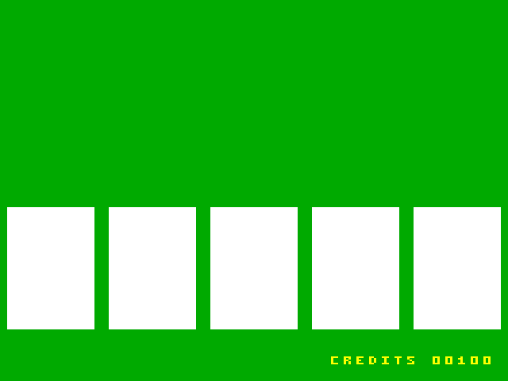
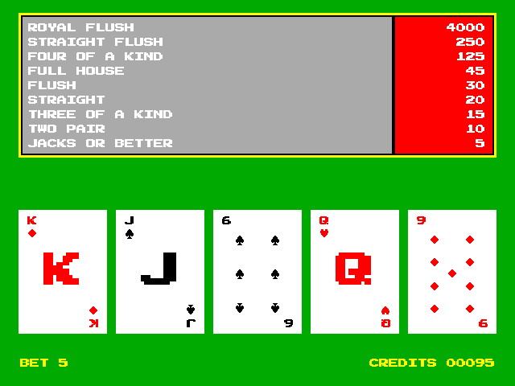
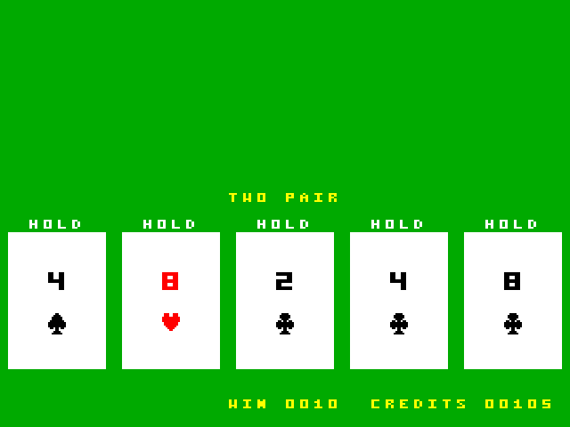
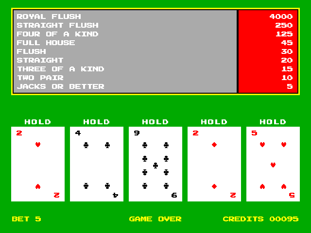

# VGA renderer behavior baseline

This document describes the reviewed baseline. This experiment removes its
payout sheet and changes the implementation; see [the experiment report](vga-area-experiment.md).

The renderer consumes poker-core state and produces external RGB/sync signals;
it does not control gameplay. All graphics and glyphs are synthesized on chip,
with no framebuffer or external image memory. This baseline preserves the
current behavior for review while area reduction continues.

## Timing and composition

At 25 MHz the raster visits 800×525 clocks, displaying the first 640×480 pixels.
HSYNC is low at x=656..751; VSYNC is low at y=490..491. Reset sets x/y to zero;
RGB is black outside the visible area. State changes affect subsequent pixels
immediately. There is no frame latch or animation, so a frame crossing a game
update can contain both states. Golden captures wait two full frame periods.

Coordinates below are in visible pixels; sizes are width×height:

| Element | Origin / spacing | Size and behavior |
| --- | --- | --- |
| Green background | (0,0) | 640×480, RGB (0,170,0) |
| Payout border | (23,16) | 594×180 yellow, black inset |
| Payout labels | panel (28,21), text x=35 | 459×170 gray, white 12px text |
| Payout values | panel (491,21), text x=555 | 121×170 red, white four-cell values |
| Payout rows | y=29+18×row | Nine rows, royal flush through jacks or better |
| Hand name | y=213 | Centered 20px cells; white in HOLD, yellow in EVALUATE/RESULT |
| HOLD labels | (51+121×card,246) | 54×12, white; persist after draw through RESULT |
| Cards | (23+121×card,261) | Five 110×154 white rectangles |
| BET 5 | (25,446) | Yellow native 12px cells |
| Result | (266,446) | Nine 12px cells: WIN 0010 or GAME OVER; yellow on green |
| CREDITS / balance | (459,446) / (555,446) | Yellow, five decimal digits, initial 00100 |

Ranks use rotated opposing corners. Cards 2–10 have exactly rank-count center
pips and no corner suits. Aces have one normal-size center pip. J/Q/K have
corner suits and a centered 48px rank letter. Hearts/diamonds are red;
clubs/spades are black. Invalid/reset card codes leave blank rectangles.
Result text stays in the footer and never obscures cards. A zero payout in
RESULT displays GAME OVER; outside RESULT the field is blank.

All text and suits share one `font_rom` instance in `vga.v`. Payout names and
hand names share one `payout_characters` instance. The core exports its existing
live evaluator category; no second evaluator is added. Credits use one serial
binary-to-decimal converter, committing a stable balance after 17 clocks
(up to 34 if it changes during conversion). Static award strings need no second
converter. The shell's temporary `keep` attributes are removed now that game
state reaches real output logic. See [font and module interfaces](font.md).

## Visual contract

The five reviewed PNG fixtures live in `test/sim/fixtures/vga/`:

| Reset | Dealt | Held |
| --- | --- | --- |
|  |  |  |

| Winning result | Losing result |
| --- | --- |
|  |  |

`make test-sim` replays the fixed-cycle schedules on Verilator and Icarus,
checks snapshots/counters, and compares decoded RGB against these fixtures.
No GUI, network, font installation, or Python image package is needed. Existing
pin-trace equivalence and malformed-sync/reset/blanking tests remain enabled.
Chip component tests stay in `test/`; auxiliary replay/capture harnesses stay
under `test/sim/`. Fixture update instructions are in [test/README.md](../test/README.md).

## Area limitation — 2026-11-17

Using upstream core optimizations from `de208ec`, production 500,000-cycle
debounce, Yosys 0.33, and the GF180 MCU 7-track 5V typical 25°C/3.3V library:

| Measurement | Area (µm²) |
| --- | ---: |
| Full active design, 3,623 mapped cells | 78,965.7344 |
| Core-only probe retaining renderer-consumed outputs | 30,772.3136 |
| Incremental renderer/integration estimate by subtraction | 48,193.4208 |
| Usable 1×1 core | 51,966.9700 |
| Excess over usable core | 26,998.7644 |

The full design is approximately 152% of usable core area. At least 34.2% of
current mapped logic must be removed just to meet that geometric limit, before
placement/routing headroom. The renderer/integration estimate is approximately
61% of the total; flattening means it is not exact cell ownership and individual
optimization savings are not additive.

The mapping recipe, from the repository root, is:

```yosys
read_verilog -sv src/*.v
synth -top tt_um_h4kyu_video_poker -flatten -noabc
dfflibmap -liberty <gf180mcu_fd_sc_mcu7t5v0__tt_025C_3v30.lib>
abc -liberty <gf180mcu_fd_sc_mcu7t5v0__tt_025C_3v30.lib> -D 40000
clean
read_liberty -lib <gf180mcu_fd_sc_mcu7t5v0__tt_025C_3v30.lib>
check -assert
stat -liberty <gf180mcu_fd_sc_mcu7t5v0__tt_025C_3v30.lib>
```

This is synthesis area, not placement/routing or timing signoff. The renderer
PR remains a draft behavior baseline. Existing physical CI remains enabled;
passing functional tests does not establish physical fit. Smaller layouts and
other functional cuts require separate measured changes to this baseline.
